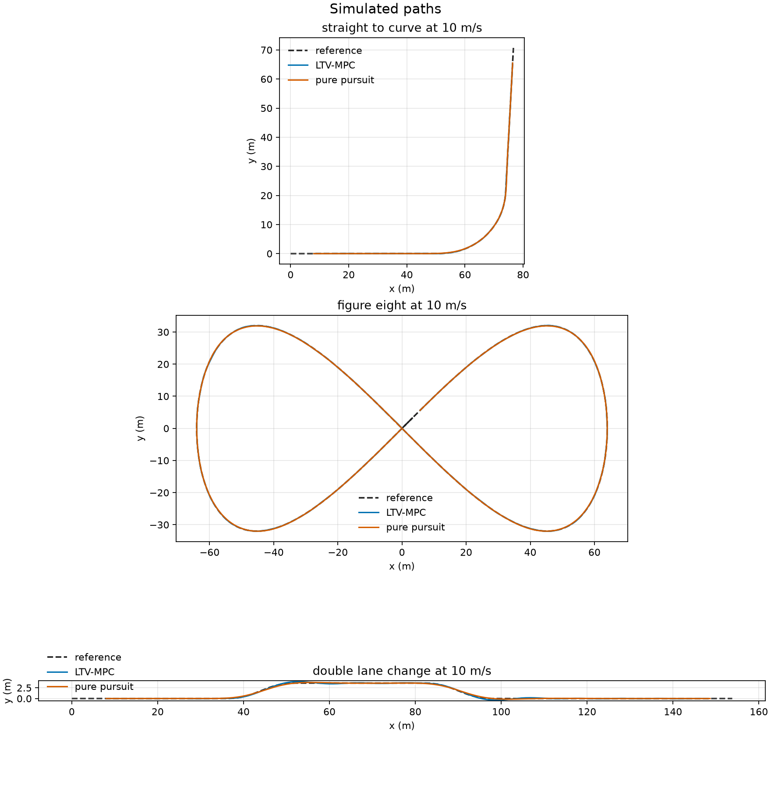
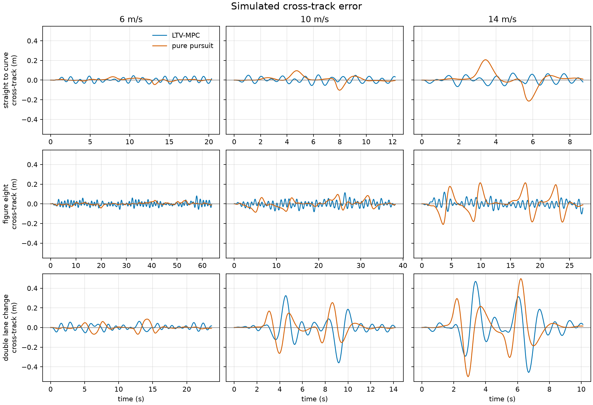
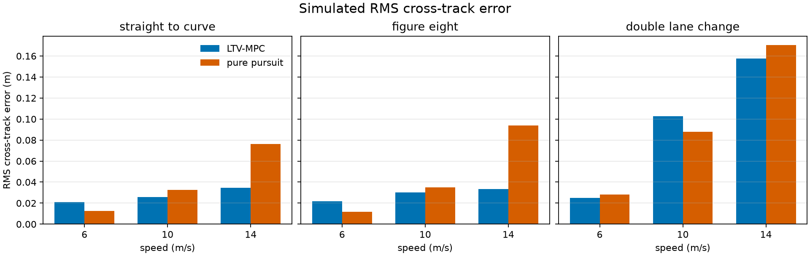

# Kinematic bicycle path tracking

Linear time-varying model predictive control (LTV-MPC) and pure pursuit, compared on a kinematic bicycle with steering and acceleration actuators. Both controllers track the same reference paths at 6, 10, and 14 m/s. The plant includes first-order actuator lag and sensor noise.

**All results are simulated.**

## Overview

The model is a planar kinematic bicycle augmented with first-order lags on steering and longitudinal acceleration. LTV-MPC linearizes that discrete-time model along a speed-scheduled path reference and solves a dense quadratic program for the steering and acceleration commands, including magnitude and rate limits. Pure pursuit uses the classical geometric steering law plus a PID speed loop. Pure pursuit saturates command magnitude. It does not enforce rate limits, so those violations are counted.

Tracking error is evaluated on the simulated truth state. Cross-track error is positive to the left of the path tangent:

```text
e_lat = -sin(psi_path) * (x - x_path) + cos(psi_path) * (y - y_path)
```

Heading error is the wrapped difference between vehicle heading and path heading, reported in degrees.

## Model

State `[x, y, psi, v, delta, accel]`, command `[delta_cmd, accel_cmd]`:

```text
x_dot     = v * cos(psi)
y_dot     = v * sin(psi)
psi_dot   = v * tan(delta) / L
v_dot     = accel
delta_dot = (delta_cmd - delta) / tau_delta
accel_dot = (accel_cmd - accel) / tau_accel
```

| Parameter | Value |
| --- | --- |
| Wheelbase `L` | 2.7 m |
| Steering limit | ±0.50 rad |
| Acceleration limit | −3.5 to 2.0 m/s² |
| Steering rate limit | 0.40 rad/s |
| Acceleration rate limit | 5.0 m/s³ |
| Steering time constant | 0.15 s |
| Acceleration time constant | 0.18 s |

The simulator and the linearization both use RK4 with a step of 0.05 s. Continuous and discrete Jacobians are analytic derivatives of that vector field and of the RK4 map.

## Controllers

### LTV-MPC

At each step the current pose is projected onto the path. A reference of horizon `N = 20` (1.0 s) is sampled at the requested speed. The steady steering for the local curvature is `atan(L * kappa)`, and the steady acceleration command is zero. The RK4 map is linearized about each reference state and command. An affine mismatch term keeps the prediction consistent when the sampled path is not an exact discrete trajectory of the model.

The decision variable is the command sequence. The quadratic cost penalizes cross-track, along-track, heading, and speed error, command deviation from the curvature feedforward, and command increments. Terminal stage weights are scaled by 5. Hard linear inequalities enforce steering limits, acceleration limits, and both rate limits, including the rate relative to the previous applied command.

The dense convex QP

```text
minimize    1/2 z^T P z + q^T z
subject to  G z <= h
```

is solved by a Mehrotra predictor-corrector interior-point method. Inequality problems use a Schur complement against the factored Hessian. Equality-constrained problems use a dense LU factorization of the KKT system. A shifted previous solution warm-starts the next step.

| Weight | Value |
| --- | --- |
| Cross-track | 8 |
| Along-track | 0.5 |
| Heading (rad²) | 6 |
| Speed | 1.2 |
| Steering command | 0.25 |
| Acceleration command | 0.10 |
| Steering rate | 0.80 |
| Acceleration rate | 0.08 |

Solver tolerance is `1e-6`, with at most 35 iterations and one retry at 70 iterations if the first attempt does not converge.

### Pure pursuit

Lookahead distance is `clamp(0.70 * v, 2.5 m, 12 m)`. Steering points the bicycle at the first path sample at least that far from the measured pose, then saturates at the steering limit. Speed is a PID loop (`Kp = 1.5`, `Ki = 0.20`, `Kd = 0`, integral limit 1.5) saturated at the acceleration limits. Rate limits are not applied to this command.

## Scenarios

Both controllers start on the path at arc length 8 m, at the scenario speed, with actuator state matched to the local curvature. Each scenario runs for `(nominal_length - 8 m) / speed`.

| Path | Geometry |
| --- | --- |
| `straight_to_curve` | 45 m straight, 14 m smooth rise to radius 22 m, 1.20 rad arc, 45 m straight |
| `figure_eight` | Lemniscate of Gerono, scale 64 m, one lap of 390.222 m, repeated so the preview stays on the loop |
| `double_lane_change` | 3.6 m offset, 18 m ramps, 28 m hold, smoothstep lateral profile |

Sensor noise is applied to the pose and speed seen by the controller. The same seed is used for both controllers on a given path and speed. Standard deviations are 0.025 m in `x` and `y`, 0.004 rad in heading, and 0.05 m/s in speed. Actuator state is not noised.

A constraint violation is one control step whose issued command exceeds a steering, acceleration, or rate limit by more than `1e-4`.

## Build and run

Requirements: CMake 3.16 or newer, a C++17 compiler, and Python 3 with Matplotlib for the figures. GoogleTest 1.14.0 is downloaded by CMake at configure time.

```bash
cmake -S . -B build -DCMAKE_BUILD_TYPE=Release
cmake --build build -j
ctest --test-dir build --output-on-failure
./build/bpt_benchmark --csv docs/benchmark.csv --trajectories docs/trajectories.csv --paths docs/paths.csv
python3 scripts/plot_benchmark.py
```

`scripts/plot_benchmark.py` reads those three CSV files and writes:

- `docs/paths_overlay.png`
- `docs/cte_over_time.png`
- `docs/rms_cte.png`

The tracking columns below are deterministic for this source and noise seed. Solve times are wall-clock measurements from the Release run that produced the committed CSV, so repeating the benchmark on another machine changes those two columns.

## Results

All results are simulated. No physical vehicle, sensor log, or road test is included. Solve time is the measured duration of the control update inside that simulation.

The numbers in this table are copied from [`docs/benchmark.csv`](docs/benchmark.csv).

| controller | path | speed_mps | rms_cte_m | max_cte_m | rms_heading_deg | max_heading_deg | mean_solve_ms | max_solve_ms | constraint_violations |
| --- | --- | --- | --- | --- | --- | --- | --- | --- | --- |
| ltv_mpc | straight_to_curve | 6 | 0.021101 | 0.044945 | 0.979424 | 1.885641 | 3.9941 | 10.1994 | 0 |
| pure_pursuit | straight_to_curve | 6 | 0.012629 | 0.045902 | 0.245168 | 1.710819 | 0.0183 | 0.0369 | 64 |
| ltv_mpc | straight_to_curve | 10 | 0.025931 | 0.055207 | 0.925878 | 1.945951 | 4.1542 | 6.0762 | 0 |
| pure_pursuit | straight_to_curve | 10 | 0.032494 | 0.102877 | 0.473747 | 2.504438 | 0.0195 | 0.0354 | 2 |
| ltv_mpc | straight_to_curve | 14 | 0.034421 | 0.071313 | 0.960772 | 1.888922 | 4.6487 | 8.8607 | 0 |
| pure_pursuit | straight_to_curve | 14 | 0.076095 | 0.213714 | 0.780494 | 3.204730 | 0.0215 | 0.0359 | 2 |
| ltv_mpc | figure_eight | 6 | 0.021841 | 0.080342 | 0.961534 | 2.787736 | 3.9934 | 10.2113 | 0 |
| pure_pursuit | figure_eight | 6 | 0.011869 | 0.042673 | 0.148912 | 0.537592 | 0.0074 | 0.1345 | 183 |
| ltv_mpc | figure_eight | 10 | 0.030042 | 0.113304 | 0.955064 | 2.570683 | 4.1250 | 9.7389 | 0 |
| pure_pursuit | figure_eight | 10 | 0.035186 | 0.095351 | 0.317122 | 1.163706 | 0.0081 | 0.0529 | 16 |
| ltv_mpc | figure_eight | 14 | 0.033275 | 0.119101 | 0.875924 | 2.151434 | 3.8409 | 7.8879 | 0 |
| pure_pursuit | figure_eight | 14 | 0.093965 | 0.213884 | 0.758520 | 2.424026 | 0.0090 | 0.0551 | 11 |
| ltv_mpc | double_lane_change | 6 | 0.024968 | 0.062938 | 0.966824 | 2.068814 | 3.9349 | 10.9359 | 0 |
| pure_pursuit | double_lane_change | 6 | 0.028184 | 0.085568 | 0.614064 | 1.934853 | 0.0145 | 0.0265 | 90 |
| ltv_mpc | double_lane_change | 10 | 0.102699 | 0.359628 | 2.108516 | 6.027094 | 4.0950 | 9.4206 | 0 |
| pure_pursuit | double_lane_change | 10 | 0.087952 | 0.262693 | 1.669727 | 4.953572 | 0.0158 | 0.0360 | 8 |
| ltv_mpc | double_lane_change | 14 | 0.157535 | 0.469588 | 2.853257 | 8.338396 | 4.4253 | 8.4874 | 0 |
| pure_pursuit | double_lane_change | 14 | 0.170383 | 0.500948 | 2.697606 | 7.169131 | 0.0189 | 0.0418 | 3 |

LTV-MPC stays inside every command constraint on all 18 runs (`constraint_violations` is 0). Mean solve time is about 4 ms per step. Pure pursuit is faster (under 0.03 ms mean) and, at 6 m/s, has a smaller RMS cross-track error on the straight-to-curve path (0.012629 m versus 0.021101 m) and on the figure-eight (0.011869 m versus 0.021841 m). Those pure-pursuit commands break the steering-rate limit on 64, 183, and 90 steps of the three 6 m/s runs.

At 14 m/s the preview matters. LTV-MPC RMS cross-track error is 0.034421 m on the straight-to-curve path (pure pursuit 0.076095 m), 0.033275 m on the figure-eight (pure pursuit 0.093965 m), and 0.157535 m on the double lane change (pure pursuit 0.170383 m). The double lane change is the hardest case for both: at 10 m/s pure pursuit still has the lower RMS cross-track error (0.087952 m versus 0.102699 m).







## Tests

GoogleTest covers:

- RK4 against straight-line, constant-acceleration, circular-arc, and actuator-lag closed forms
- continuous and discrete Jacobians against central finite differences
- the QP solver on unconstrained, bound, equality, half-plane, and rate-limited problems with known solutions
- LTV-MPC command limits and rate limits on a tight curve
- both controllers closing the loop onto a straight line from a lateral and heading offset

## Layout

```text
include/bpt/     public headers
src/             model, path, QP, controllers, simulator, benchmark
tests/           GoogleTest sources
scripts/         plot_benchmark.py
docs/            benchmark CSV, trajectories, and figures
.github/workflows/ci.yml
```

## License

MIT. See [LICENSE](LICENSE).
